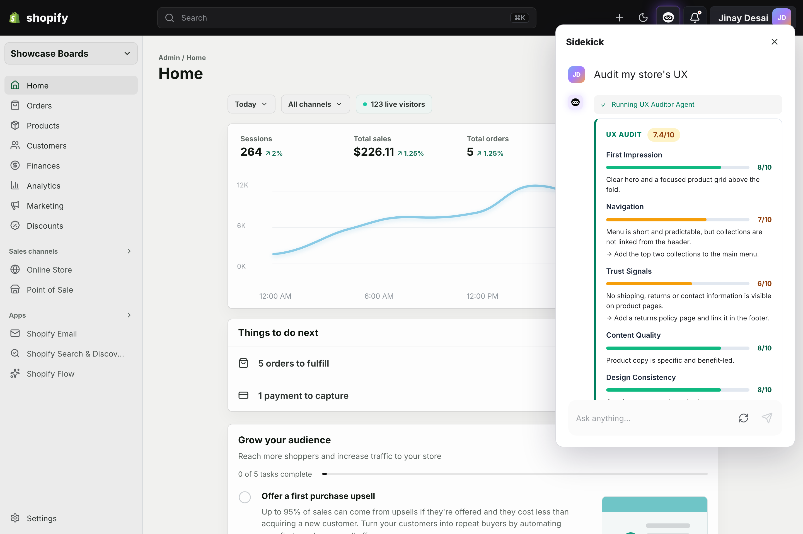

# Sidekick for Shopify Admin

An agentic AI assistant embedded in a Shopify Admin–style dashboard. Merchants ask in plain English and Sidekick reads their Google Drive, launches products to a live Shopify store, audits the storefront, and manages the theme — with a human confirmation gate on anything destructive.

**Demo:** https://youtu.be/bAQ27cwsIN8



*The Sidekick panel rendering a UX audit report. This screenshot is generated from sample audit data with the network calls mocked; the video above shows the real agents running against a live dev store.*

Built with React 19 + Vite on the front end, a dependency-free Node HTTP server on the back end, the Anthropic Messages API (tool use) for the agents, and the Shopify Admin REST/GraphQL APIs.

## What it does

| Capability | How it works |
| --- | --- |
| **Drive → live product** | "Scan my Drive and launch the rain jacket." Searches Drive, reads the doc, extracts a structured product draft (title, price, tags, variants, media), lets the merchant edit it, then publishes it to the store as ACTIVE across sales channels. |
| **Storefront audits** | Three specialised agents: a **UX Auditor** (scores 5 dimensions against a fixed rubric), a **Product Clarity** agent (infers audience and scores every listing), and a **Discoverability Scout** (simulates shopper queries with a "cold" Claude to check whether an AI shopping assistant would recommend your products). Results render as score cards in the chat. |
| **Store management** | Create/update pages and collections, edit theme settings, list and activate themes, publish/unpublish/delete products. |
| **Intent routing** | A lightweight planner call classifies each message (`chat`, `files`, `product_create`, `storefront_agent`) so simple questions don't spin up tools. |
| **Streaming UI** | The server streams NDJSON events (`plan`, `tool_call`, `tool_result`, `audit_report`, `final`) so the panel shows live agent activity. |

## Architecture

```
React (Vite)  ──/api/chat (NDJSON stream)──▶  Node server (server/routes.js)
  Sidekick panel                                 ├─ planner      (intent routing, Haiku)
  Audit cards                                    ├─ Drive agent  (search → rerank → extract)
                                                 ├─ Storefront agent (Claude tool-use loop, ≤10 rounds)
                                                 │     ├─ Shopify Admin REST / GraphQL
                                                 │     └─ audit agents (batched, prompt-cached)
                                                 └─ confirmation gate (server/lib/confirm.js)
```

Key design decisions:

- **Server-enforced human-in-the-loop.** `delete_*`, `unpublish_product` and `activate_theme` are *held* the first time the agent calls them. The agent must ask the user, and the action only runs when the same call is repeated from a **later user turn**. The model cannot approve its own action within a run, whatever it says. See `server/lib/confirm.js` and its tests.
- **Local API hardening.** Binding to `127.0.0.1` doesn't stop a web page in your browser from calling localhost, and some endpoints can delete products or switch the live theme. `server/lib/guard.js` rejects foreign `Origin`s (CSRF), unexpected `Host` headers (DNS rebinding), and non-JSON `POST`s (cross-site "simple requests").
- **Rate-limit aware fan-out.** Per-product and per-query scoring runs through `batchMap` (bounded concurrency) instead of an unbounded `Promise.all`.
- **Prompt caching** on the large, stable system prompts used by the reasoning/rerank calls.
- **Secrets stay server-side.** The browser never sees API keys; OAuth tokens are stored in a gitignored file.
- **No framework on the server.** Plain `node:http` keeps the request/stream handling explicit and the dependency surface tiny.

## Getting started

Prerequisites: Node 20+, an Anthropic API key, a Shopify development store with a custom app (Admin API token), and optionally a Google OAuth client for Drive.

```bash
npm install
cp .env.example .env     # fill in your own keys — never commit .env
npm run api              # API on http://127.0.0.1:8787
npm run dev              # app on http://127.0.0.1:5173 (proxies /api)
```

Other scripts: `npm test` (unit tests), `npm run lint`, `npm run build`.

## Project layout

```
src/
  App.jsx                    app shell, navigation, search
  components/dashboard/      mock admin views (home, orders, products, customers)
  components/sidekick/       chat panel, audit cards, product draft card, visuals
  data/mockData.js           mock dashboard data
server/
  index.js                   entry point (creates the HTTP server)
  routes.js                  route table
  config.js                  env loading and shared config
  agents/                    storefront agent loop, tool schemas + handlers, audits,
                             product launch, Drive chat
  integrations/              Anthropic, Shopify Admin, Google/Microsoft Drive, OAuth
  prompts/                   system prompts
  lib/                       confirmation gate, request guard, HTTP + JSON helpers
test/                        node:test suites
docs/                        design notes and screenshots
```

## What was hard

- **Giving a model a delete button.** An agent that can call `delete_product` or `activate_theme` will eventually do it when it shouldn't. Prompting it to "ask first" isn't a control, so the gate lives in server code: destructive calls are held and only run when the same call arrives from a later user turn. The tests cover self-approval, changed arguments and expiry.
- **Rate limits from fan-out.** Scoring every product and simulating every shopper query with `Promise.all` hit Anthropic's concurrency limits as catalogs grew. `batchMap` bounds concurrency while keeping result order.
- **Reliable structured output.** Models wrap JSON in prose. `parseJson` falls back to the first `{...}` block and then to a caller-supplied default, so one bad response degrades a single score instead of failing the whole audit.
- **Judging "would an AI recommend this?"** The Discoverability Scout uses a *separate*, context-free Claude call per query. Sharing context with the store-owner agent would bias it toward recommending the merchant's own products.
- **A local API that can modify a live store.** See the request guard above.

## Known limitations

- Single-merchant, single-store demo: the API guard protects against hostile web pages, but there are no user accounts, and OAuth tokens live in a local file.
- Product creation sets title, description, tags, media and a single price. Multi-variant options, inventory levels and metafields aren't created yet.
- Test coverage targets the safety-critical paths: the confirmation gate (including an end-to-end agent-loop test with Anthropic and Shopify mocked), the request guard, batching and JSON parsing. Audits, Drive search and the UI have no automated tests yet.
- The dashboard data (orders, customers, analytics) is mocked; only products, pages, themes and collections are live.
- Confirmation holds are in-memory and reset when the server restarts.

## Credits

Originally started as a collaboration with Sai Kodakalla, who built the initial dashboard shell and the Google Drive integration. The agentic product launch, Shopify publishing, storefront audit agents, theme tools, confirmation gate and tests were added on top by Jinay Desai.
